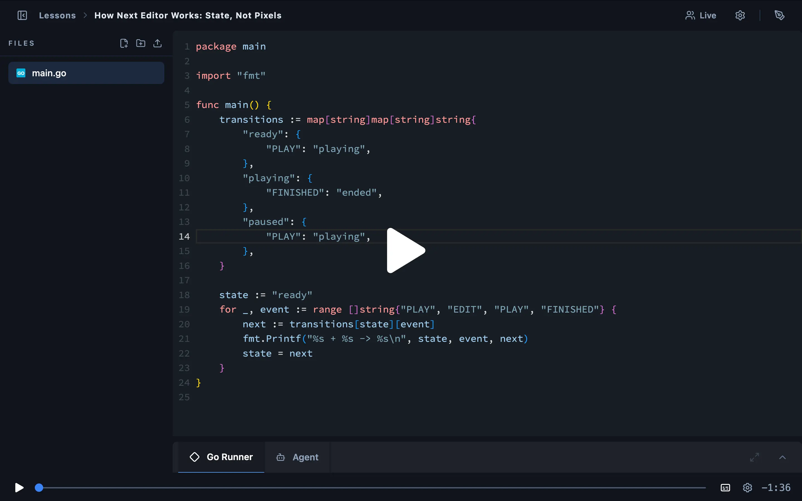

# Hi, I'm Chan Nyein Tun 👋

  
  
  
  

---

## 🛠️ What I'm building

###  Next Editor — coding lessons you can pause, edit and run

**[nexteditor.dev](https://nexteditor.dev)** · **[source](https://github.com/channyeintun/next-editor)** ·  · 4,000+ commits

A coding video you can step into. A lesson plays like a video, but what you are watching is a real editor: press pause, change the code, run it, then carry on from where you stopped. It all happens in a browser tab, with nothing to install.

I use it to teach. So far that is **420+ lessons, 55+ hours, 13 courses**, most of them narrated in Burmese. The editor's built-in studio types the code, narrates it and runs it, and each lesson passes automated checks before I publish it.

---

## ✍️ Writing

35+ articles in English and Burmese on [my GitBook](https://channyeintun.gitbook.io/blogs). A few favourites:

- [The Anatomy of an Agent Harness](https://channyeintun.gitbook.io/blogs/ai/the-anatomy-of-an-agent-harness)
- [Harness Engineering: How to Build Software When Humans Steer, Agents Execute](https://channyeintun.gitbook.io/blogs/ai/harness-engineering-how-to-build-software-when-humans-steer-agents-execute)
- [XState Under The Hood](https://channyeintun.gitbook.io/blogs/javascript/xstate-under-the-hood)
- [Web Accessibility](https://channyeintun.gitbook.io/blogs/accessibility/web-accessibility)

---

## 🧰 How I work

Most of my work now starts as a prompt, a plan, and a review.

- **Every day:** TypeScript · React · Next.js · Node.js · NestJS · PostgreSQL · Cloudflare
- **Also:** Go · Rust · Java · React Native
- **Coding agents:** Claude Code · Codex · GitHub Copilot · Antigravity

---

If **[Next Editor](https://github.com/channyeintun/next-editor)** looks useful to you, a ⭐ goes a long way.

